# Proyecto Final - Microservicios

## Estado actual

El repositorio contiene la evolución acumulada de los Retos 1 a 6. Los Retos 1 a 5 están implementados a nivel funcional; el Reto 6 incorpora la estrategia de pruebas automatizadas y requiere ejecutar las suites en la máquina del equipo para generar las evidencias finales.

Documentos de referencia del repositorio:

- [`docs/arquitectura.md`](docs/arquitectura.md): arquitectura actual.
- [`docs/eventos.md`](docs/eventos.md): eventos, colas y consumidores implementados.
- [`.env.example`](.env.example): variables necesarias para levantar el ecosistema.

## Arquitectura actual

El cliente accede únicamente por el API Gateway en `http://localhost:8080`. Los puertos internos de los microservicios no se publican al host. RabbitMQ expone solo su interfaz administrativa en `http://localhost:15672`.

| Servicio | Lenguaje / stack | Puerto interno | Función |
|---|---|---:|---|
| API Gateway | Java 21 / Spring Cloud Gateway | 8080 | Punto de entrada, validación JWT, RBAC/propiedad y enrutamiento |
| Gestión de empleados | Java 21 / Spring Boot | 8081 | Empleados, auditoría, eventos y Circuit Breaker |
| Gestión de departamentos | Python / FastAPI | 8082 | Departamentos |
| Notificaciones | Node.js / Express | 8083 | Consumidor reactivo e historial de notificaciones |
| Perfiles | Go | 8084 | Perfil sincronizado por eventos + REST |
| Vacaciones | C# / ASP.NET Core 8 | 8085 | Períodos, scheduler y eventos |
| Auth | C# / ASP.NET Core 8 | 8086 | Identidad, contraseñas y JWT |

```text
Cliente HTTP
     |
     +-----------------------------+
     |                             |
 localhost:8080              localhost:8000
     |                             |
gestion-empleados --------HTTP----> gestion-departamentos
 Java 21 / Spring                  Python 3.11 / FastAPI
     |                             |
     | SQL                         | SQL
     v                             v
database-empleados          database-departamentos
 PostgreSQL                    PostgreSQL
     |                             |
 empleados-db-data       departamentos-db-data
```

Cada servicio persistente posee su propia base PostgreSQL. La comunicación síncrona entre servicios se limita principalmente a Empleados -> Departamentos; el resto del ciclo de vida se propaga mediante RabbitMQ y el exchange `rrhh.events`.

## Puesta en marcha

1. Copie `.env.example` como `.env` y ajuste las credenciales si es necesario.
2. Levante el sistema:

```powershell
docker compose up -d --build
```

3. Compruebe el estado:

```powershell
docker compose ps -a
```

4. El Gateway queda en `http://localhost:8080` y RabbitMQ Management en `http://localhost:15672`.

4. El Gateway queda en `http://localhost:8080` y RabbitMQ Management en `http://localhost:15672`.

| Microservicio | Tecnología | Estado |
|---------------|------------|--------|
| API Gateway | Spring Cloud Gateway + Java 21 | 🟢 Reto 3 y 5 completos — Validación JWT y RBAC |
| Gestión de empleados | Spring Boot + Java 21 | 🟢 Retos 1, 2, 4 completos — [Ver documentación](microservicios/gestion-empleados/README.md) |
| Gestión de departamentos | Python 3.11 + FastAPI | 🟢 Reto 2 completo — [Ver documentación](microservicios/gestion-departamentos/README.md) |
| Autenticación | .NET 8 + ASP.NET Core | 🟢 Reto 5 completo — [Ver documentación](microservicios/auth-service/README.md) |
| Gestión de perfiles | Go 1.23 + Fiber | 🟢 Reto 4 completo |
| Gestión de vacaciones | .NET 8 + ASP.NET Core | 🟢 Retos 4 y 5 completos — Scheduler implementado |
| Notificaciones | Node.js 22 + Express | 🟢 Retos 4 y 5 completos — Integrado con eventos de seguridad |

Para las pruebas E2E del Reto 6 use temporalmente `ENABLE_DEV_ENDPOINTS=true`; en uso normal manténgalo en `false`.

## Pruebas automatizadas — Reto 6

| Suite | Comando | Resultados | Cobertura |
|---|---|---|---|
| Empleados unitarias + integración | `cd microservicios/gestion-empleados` + `./mvnw.cmd verify` | `target/surefire-reports/*.xml` | `target/site/jacoco/jacoco.xml` |
| Vacaciones unitarias | `cd microservicios/vacaciones-service` + `./run-tests.ps1` | `reports/results.trx` | `reports/coverage.xml` |
| BDD / E2E | `cd e2e-tests` + `npm ci` + `npm test` | `reports/junit.xml`, `reports/cucumber.json`, `reports/cucumber.html` | — |

Los reportes se generan localmente y no se versionan; serán consumidos por el pipeline del reto siguiente.

## Documentación histórica

Las secciones siguientes conservan decisiones y evidencias de los retos anteriores. Algunas URLs directas de microservicios pertenecen al momento histórico del reto correspondiente; en el estado actual toda API de negocio se consume a través del Gateway.

## Tecnologías

Las tecnologías utilizadas hasta el Reto 2 son:

| Tecnología | Uso |
|---|---|
| Java 21 | Lenguaje de `gestion-empleados` |
| Spring Boot 4.1.0 | Framework de `gestion-empleados` |
| Spring Data JPA | Persistencia de empleados |
| Hibernate | Implementación ORM y generación/actualización del esquema de empleados |
| PostgreSQL 18 | Base de datos de empleados y departamentos |
| Python 3.11 | Lenguaje de `gestion-departamentos` |
| FastAPI | API REST de departamentos |
| Pydantic | Validación de datos y esquemas OpenAPI |
| SQLAlchemy | Persistencia de departamentos |
| psycopg2-binary | Conexión de Python con PostgreSQL |
| Docker | Contenerización |
| Docker Compose | Orquestación de servicios |
| Springdoc OpenAPI | Swagger/OpenAPI de empleados |
| Pytest | Pruebas automatizadas de departamentos |

## Ejecución

La solución del Reto 2 puede levantarse desde la raíz del proyecto mediante un único comando:

```bash
docker compose up --build
```

Para detener el sistema conservando los volúmenes:

```bash
docker compose down
```

Para detener el sistema y eliminar también los volúmenes:

```bash
docker compose down -v
```

La configuración de las bases de datos se encuentra preparada mediante variables de entorno. El archivo `.env` contiene las credenciales y no debe versionarse en Git.

### Verificación de arranque ordenado

El proyecto utiliza `healthcheck` en los servicios de base de datos y en el microservicio de gestión de departamentos. Además, `gestion-empleados` utiliza `depends_on` con la condición `service_healthy`, garantizando que sus dependencias estén disponibles antes de iniciar.

Para levantar el proyecto desde cero se ejecuta:

```bash
docker compose up --build
```

Luego se puede verificar el estado de los contenedores mediante:

```bash
docker compose ps
```

La salida permite comprobar que los servicios que funcionan como dependencias se encuentran en estado `healthy`, especialmente:

- `database-empleados`
- `database-departamentos`
- `gestion-departamentos`

Esto evidencia el arranque ordenado de los servicios y la verificación de disponibilidad mediante los `healthcheck` configurados en Docker Compose.

**Ruta de la evidencia:**

```text
docs/evidencias/reto2/docker/R2-02-compose-ps.png
```

### Infraestructura Docker

El `docker-compose.yml` define:

- `gestion-empleados`
- `gestion-departamentos`
- `database-empleados`
- `database-departamentos`
- red interna `microservices-network`
- volumen `empleados-db-data`
- volumen `departamentos-db-data`
- variables de entorno
- health checks
- dependencias con `condition: service_healthy`

Cada servicio de negocio posee su propio Dockerfile.

### Persistencia de datos

Cada microservicio administra su propia base de datos PostgreSQL y su propio volumen.

Los datos deben sobrevivir al ciclo:

```bash
docker compose down
docker compose up -d
```

y deben eliminarse cuando se utiliza:

```bash
docker compose down -v
```

**Evidencia de persistencia después de `down`:**

```text
docs/evidencias/reto2/docker/R2-05-persistencia-down.png
```

**Evidencia de eliminación después de `down -v`:**

```text
docs/evidencias/reto2/docker/R2-06-persistencia-down-v.png
```

### Creación reproducible del esquema

Para el Reto 2 se utiliza auto-DDL.

En empleados:

```text
spring.jpa.hibernate.ddl-auto=update
```

Hibernate crea o actualiza el esquema de la entidad `Empleado`.

En departamentos:

```text
Base.metadata.create_all(bind=engine)
```

SQLAlchemy crea las tablas al iniciar la aplicación cuando todavía no existen.

Esta decisión evita pasos manuales adicionales al levantar las bases de datos desde cero. Los archivos `scripts/init-db.sql` y `scripts/seed-data.sql` permanecen como parte de la estructura general, pero no constituyen el mecanismo activo de creación del esquema en este reto.

### Comunicación entre servicios

La comunicación entre empleados y departamentos se realiza mediante HTTP REST.

Dentro de Docker se utiliza:

```text
http://gestion-departamentos:8000
```

La validación de un departamento se realiza mediante:

```text
GET http://gestion-departamentos:8000/departamentos/{id}
```

Esto garantiza que cada microservicio sea propietario exclusivamente de sus propios datos.

**Evidencia de comunicación REST:**

```text
docs/evidencias/reto2/integracion/R2-18-comunicacion-rest.png
```

### Validaciones del registro de empleados

El flujo implementado para registrar un empleado es:

1. Verificar que el email no exista.
2. Verificar que el `numeroEmpleado` no exista.
3. Consultar el departamento mediante REST.
4. Si el departamento existe, establecer `estado = ACTIVO`.
5. Guardar el empleado en PostgreSQL.
6. Si PostgreSQL detecta una violación de unicidad por concurrencia, convertirla en una respuesta controlada.

Las tres validaciones evaluables del Reto 2 son:

| Caso | Resultado esperado |
|---|---|
| Email duplicado | `400 Bad Request` |
| `numeroEmpleado` duplicado | `400 Bad Request` |
| Departamento inexistente | `400 Bad Request` |

**Evidencias:**

```text
docs/evidencias/reto2/postman/R2-12-email-duplicado.png
docs/evidencias/reto2/postman/R2-13-numero-duplicado.png
docs/evidencias/reto2/postman/R2-14-departamento-no-existe.png
```

### Timeout, reintentos y fallo parcial

`gestion-empleados` incorpora protección para las llamadas al servicio de departamentos:

| Mecanismo | Configuración |
|---|---|
| Timeout de conexión | 2 segundos |
| Timeout de lectura | 2 segundos |
| Máximo de intentos | 4 |
| Esperas | 1 s, 2 s y 4 s |
| Resultado después del agotamiento | `503 Service Unavailable` |

Cuando departamentos permanece indisponible, el empleado no se guarda.

**Evidencia:**

```text
docs/evidencias/reto2/integracion/R2-19-timeout-retry-503.png
```

### Swagger / OpenAPI

`gestion-empleados`:

```text
Swagger UI:
http://localhost:8080/swagger-ui.html

OpenAPI:
http://localhost:8080/v3/api-docs
```

`gestion-departamentos`:

```text
Swagger UI:
http://localhost:8000/docs

ReDoc:
http://localhost:8000/redoc

OpenAPI:
http://localhost:8000/openapi.json
```

**Evidencias:**

```text
docs/evidencias/reto2/swagger/R2-20-swagger-empleados.png
docs/evidencias/reto2/swagger/R2-21-swagger-departamentos.png
```

### Evidencias del Reto 1

El Reto 1 corresponde al estado histórico del servicio `gestion-empleados`, cuando los empleados se almacenaban en memoria mediante `ConcurrentHashMap`.

**Ubicación:**

```text
docs/evidencias/reto1/
```

```text
R1-01-registro-empleado.png
R1-02-email-duplicado.png
R1-03-numero-duplicado.png
R1-04-get-empleado.png
R1-05-empleado-no-existe.png
R1-06-ruta-no-soportada.png
R1-07-docker.png
```

### Evidencias del Reto 2

```text
docs/evidencias/reto2/
```

## Estado al finalizar el Reto 2

El Reto 2 deja implementados:

- Dos servicios de negocio independientes.
- Java 21 + Spring Boot para empleados.
- Python 3.11 + FastAPI para departamentos.
- Una base de datos PostgreSQL independiente por servicio.
- Volúmenes Docker independientes.
- Red interna Docker.
- Variables de entorno.
- Health checks.
- `depends_on` con `service_healthy`.
- Persistencia mediante PostgreSQL.
- Comunicación REST entre servicios.
- Validación de existencia del departamento.
- Unicidad de email y `numeroEmpleado`.
- Timeout y reintentos.
- Swagger/OpenAPI en ambos servicios.
- Dockerfile por servicio.
- Despliegue mediante `docker compose up --build`.

## Decisiones técnicas

En el desarrollo del Reto 2 se tomaron tres decisiones técnicas principales. 

### 1. Motor de base de datos por servicio

Se decidió utilizar **PostgreSQL como motor de base de datos para ambos microservicios**, manteniendo una base de datos independiente para cada servicio.

- `gestion-empleados` utiliza la base de datos `gestion_empleados`.
- `gestion-departamentos` utiliza la base de datos `gestion_departamentos`.

Aunque los dos servicios utilizan el mismo motor, sus bases de datos están completamente separadas. El microservicio de empleados no accede directamente a las tablas de departamentos; cuando necesita validar un `departamentoId`, realiza una solicitud HTTP REST al microservicio `gestion-departamentos`.

**¿Qué se ganó con esta decisión?**

- Se mantiene la independencia de los microservicios.
- Se utiliza un motor conocido y adecuado para datos relacionales.
- Se simplifica la configuración y operación del proyecto al trabajar con un único motor.
- PostgreSQL permite manejar restricciones de integridad, persistencia y transacciones.
- Se facilita la ejecución del sistema mediante Docker Compose.

**¿Qué se sacrificó o costó?**

Se renunció a utilizar motores diferentes para aprovechar la persistencia políglota. Esto significa que no se explota la posibilidad de seleccionar un motor diferente según las necesidades específicas de cada servicio.

Sin embargo, para este proyecto se consideró que utilizar PostgreSQL en ambos servicios reduce la complejidad operacional y permite concentrar el esfuerzo en la comunicación entre microservicios, persistencia, validaciones y tolerancia a fallos.

La independencia se mantiene a nivel de servicio y de base de datos, aunque el motor utilizado sea el mismo.

---

### 2. Creación del esquema

Se decidió utilizar **auto-DDL mediante los ORM** para la creación del esquema de las bases de datos.

En `gestion-empleados`, el esquema es administrado mediante **Hibernate/JPA**, utilizando:

`spring.jpa.hibernate.ddl-auto=update`

En `gestion-departamentos`, el esquema es creado mediante **SQLAlchemy**, utilizando:

`Base.metadata.create_all(bind=engine)`

Esta decisión permite que las tablas necesarias sean creadas automáticamente cuando los servicios se inicializan, evitando depender de una ejecución manual de scripts SQL para levantar el proyecto desde cero.

**¿Qué se ganó con esta decisión?**

- Configuración inicial sencilla.
- El proyecto puede levantar las estructuras necesarias automáticamente.
- Se reduce la cantidad de pasos manuales para ejecutar el sistema.
- El esquema se encuentra relacionado directamente con los modelos utilizados por cada servicio.
- Facilita el desarrollo y las pruebas del Reto 2.

**¿Qué ocurre cuando el esquema tenga que cambiar y ya existan datos?**

El uso de auto-DDL es conveniente para el desarrollo y las pruebas, pero tiene limitaciones cuando el sistema evoluciona y existen datos importantes.

En un entorno de producción, no se recomienda depender de `ddl-auto=update` o de `create_all()` como estrategia principal para controlar cambios complejos del esquema. Para cambios que requieran transformaciones de datos, renombrar columnas, eliminar estructuras o mantener compatibilidad entre versiones, sería más adecuado utilizar un sistema de **migraciones versionadas**, como Flyway, Liquibase o Alembic.

Por lo tanto, se eligió auto-DDL porque simplifica el objetivo del Reto 2 y permite reproducir la creación inicial del esquema, dejando las migraciones versionadas como una mejora para una evolución posterior del sistema.

---

### 3. Garantía de unicidad

Se decidió utilizar **una combinación de validación previa en la aplicación y restricciones de unicidad en la base de datos**.

Antes de registrar un empleado, `gestion-empleados` realiza las siguientes validaciones en este orden:

1. Verifica que el `email` no exista.
2. Verifica que el `numeroEmpleado` no exista.
3. Consulta mediante REST al microservicio `gestion-departamentos` para comprobar que el departamento exista.
4. Si todas las validaciones son correctas, registra el empleado.

Además, la base de datos mantiene las restricciones de unicidad correspondientes para evitar duplicados a nivel de persistencia.

La validación previa permite proporcionar una respuesta clara al usuario, mientras que la restricción `UNIQUE` de la base de datos funciona como garantía definitiva de integridad.

**¿Qué ocurre si dos peticiones con el mismo email llegan al mismo tiempo?**

Una consulta previa por sí sola no garantiza la unicidad en un escenario concurrente. Por ejemplo, dos peticiones podrían consultar al mismo tiempo y ambas comprobar que el correo todavía no existe.

Por esta razón, la restricción `UNIQUE` de la base de datos es necesaria como última barrera. Si dos peticiones concurrentes intentan guardar el mismo `email`, PostgreSQL permite que solo una operación cumpla la restricción y rechaza la otra.

La aplicación captura el error de integridad generado por la base de datos y lo transforma en una respuesta controlada para el cliente.

De esta manera se obtiene:

- Validación previa para proporcionar mensajes claros.
- Restricción de base de datos para garantizar la integridad.
- Protección frente a condiciones de carrera.
- Respuesta `400 Bad Request` cuando se intenta registrar un email o `numeroEmpleado` duplicado.

---

## Reto 5 – Seguridad y Control de Acceso con JWT

Implementa autenticación mediante JWT y protege todos los endpoints con control de acceso RBAC (basado en roles) y ABAC (basado en atributos).

### Componentes Nuevos

**Auth-Service (.NET 8)** — Puerto 8086
- `POST /auth/login` - Retorna JWT de acceso
- `POST /auth/recover-password` - Inicia recuperación de contraseña
- `POST /auth/reset-password` - Establece/cambia contraseña con token
- `POST /auth/change-password` - Cambio de contraseña (requiere JWT)
- Consume: `empleado.creado`, `empleado.retirado`, `vacaciones.iniciadas`, `vacaciones.finalizadas`
- Publica: `usuario.creado`, `cuenta.activada`, `cuenta.desactivada`, `usuario.recuperacion`

**API Gateway** — Actualizado con JwtAuthenticationFilter
- Valida JWT con HMAC-SHA256
- Aplica reglas RBAC: rol `ADMIN` (acceso total), rol `USER` (solo lectura)
- Aplica reglas ABAC: USER puede modificar solo su propio perfil (`PUT /perfiles/{id}` donde `id == token.sub`)
- Propaga identidad a microservicios: `X-User-Id`, `X-User-Role`

**Vacaciones-Service** — Actualizado con Scheduler
- `VacationSchedulerWorker.cs` ejecuta cada 60 segundos (configurable)
- Detecta períodos que inician y publica `vacaciones.iniciadas`
- Detecta períodos que finalizan y publica `vacaciones.finalizadas`
- Endpoints de desarrollo (solo con `ENABLE_DEV_ENDPOINTS=true`):
  - `POST /vacaciones/{id}/forzar-inicio`
  - `POST /vacaciones/{id}/forzar-fin`

**Notificaciones-Service** — Actualizado
- Consume eventos de seguridad: `usuario.creado`, `usuario.recuperacion`, `cuenta.activada`, `cuenta.desactivada`
- Simula envío de correos con tokens de activación/recuperación

### Estados de Cuenta

| Estado | Login | Transiciones |
|--------|-------|--------------|
| `INACTIVA` | ❌ | → ACTIVA (reset-password) / → DESACTIVADA_PERMANENTE (retiro) |
| `ACTIVA` | ✅ | → SUSPENDIDA_TEMPORAL (vacaciones) / → DESACTIVADA_PERMANENTE (retiro) |
| `SUSPENDIDA_TEMPORAL` | ❌ | → ACTIVA (fin vacaciones) / → DESACTIVADA_PERMANENTE (retiro) |
| `DESACTIVADA_PERMANENTE` | ❌ | Estado terminal (no reversible) |

**Caso borde:** Si un empleado es retirado durante vacaciones, al finalizar el período NO se reactiva la cuenta (queda en `DESACTIVADA_PERMANENTE`).

### Tokens JWT

**Access Token** (60 min):
```json
{
  "sub": "E001",
  "role": "ADMIN",
  "email": "juan@empresa.com",
  "iss": "auth-service",
  "exp": 1790806609
}
```

**Reset Token** (60 min activación / 15 min recuperación):
```json
{
  "sub": "E001",
  "type": "RESET_PASSWORD",
  "pv": "E3B0C44298FC1C14",
  "iss": "auth-service",
  "exp": 1790806655
}
```

### Configuración (.env)

```bash
# JWT (clave simétrica HMAC-SHA256 - académico)
JWT_SECRET=clave-academica-reto5-cambiar-en-produccion-0123456789
JWT_ISSUER=auth-service
ACCESS_TOKEN_MINUTES=60
ACTIVATION_TOKEN_MINUTES=60
RECOVERY_TOKEN_MINUTES=15

# Administrador semilla (se crea automáticamente)
ADMIN_EMPLEADO_ID=admin
ADMIN_EMAIL=admin@empresa.com
ADMIN_PASSWORD=Admin12345

# Base de datos auth
AUTH_DB=auth
AUTH_DB_USER=auth
AUTH_DB_PASSWORD=auth
```

### Flujo de Pruebas

```bash
# 1. Login admin
curl -X POST http://localhost:8080/auth/login \
  -H 'Content-Type: application/json' \
  -d '{"email":"admin@empresa.com","password":"Admin12345"}'

# 2. Usar token (guardar en variable TOKEN_ADMIN)
curl http://localhost:8080/empleados \
  -H "Authorization: Bearer $TOKEN_ADMIN"

# 3. Crear departamento y empleado (requiere ADMIN)
curl -X POST http://localhost:8080/departamentos \
  -H "Authorization: Bearer $TOKEN_ADMIN" \
  -H 'Content-Type: application/json' \
  -d '{"id":"IT","nombre":"Tecnología","descripcion":"Desarrollo"}'

curl -X POST http://localhost:8080/empleados \
  -H "Authorization: Bearer $TOKEN_ADMIN" \
  -H 'Content-Type: application/json' \
  -d '{
    "id":"E001",
    "nombre":"Juan",
    "apellido":"Perez",
    "email":"juan@empresa.com",
    "numeroEmpleado":"EMP-001",
    "cargo":"Dev",
    "area":"Backend",
    "departamentoId":"IT",
    "fechaIngreso":"2026-09-30",
    "estado":"ACTIVO"
  }'

# 4. Verificar eventos en logs
docker logs notificaciones-service --tail 20 | grep "SEGURIDAD"
# Extraer el token de activación del log

# 5. Activar cuenta del empleado
curl -X POST http://localhost:8080/auth/reset-password \
  -H 'Content-Type: application/json' \
  -d '{"token":"TOKEN_DEL_LOG","newPassword":"Juan12345"}'

# 6. Login como empleado
curl -X POST http://localhost:8080/auth/login \
  -H 'Content-Type: application/json' \
  -d '{"email":"juan@empresa.com","password":"Juan12345"}'

# 7. Probar RBAC (USER puede leer pero no escribir)
curl http://localhost:8080/empleados -H "Authorization: Bearer $TOKEN_USER"  # OK
curl -X DELETE http://localhost:8080/empleados/E001 -H "Authorization: Bearer $TOKEN_USER"  # 403

# 8. Probar ABAC (USER puede modificar solo su propio perfil)
curl -X PUT http://localhost:8080/perfiles/E001 \
  -H "Authorization: Bearer $TOKEN_USER" \
  -H 'Content-Type: application/json' \
  -d '{"telefono":"555-1234","ciudad":"Bogotá"}'  # OK

curl -X PUT http://localhost:8080/perfiles/E002 \
  -H "Authorization: Bearer $TOKEN_USER" \
  -H 'Content-Type: application/json' \
  -d '{"telefono":"555-9999"}'  # 403
```

### Limitaciones Conocidas

**Scheduler de Vacaciones:**
- Funciona correctamente con 1 instancia del `vacaciones-service`
- Con N instancias, cada una ejecuta su propio scheduler (N eventos duplicados)
- Deduplicación en consumidores mitiga pero no elimina trabajo redundante
- Solución: Lock distribuido (ShedLock) para Reto 31

**Seguridad JWT:**
- Usa clave simétrica HMAC-SHA256 (académico)
- Producción requeriría RS256/ES256 o JWKS con rotación de claves
- `JWT_SECRET` debe estar en gestor de secretos, no en `.env`

---

## Reto 7 – Pipeline de CI/CD con Jenkins

Implementa un pipeline completo de Integración Continua y Entrega Continua usando Jenkins, SonarQube y Docker Registry local.

### Infraestructura de CI

**Jenkins** (puerto 9090)
- Configuración automática con JCasC (Jenkins Configuration as Code)
- 2 pipelines pre-configurados: `gestion-empleados` y `gestion-departamentos`
- Ejecutor único para evitar conflictos de puertos en E2E

**SonarQube** (puerto 9000)
- Análisis estático de calidad de código (Java y Python)
- Quality Gates que bloquean builds con deuda técnica
- Base de datos PostgreSQL dedicada

**Docker Registry** (puerto 5000)
- Registro local para almacenar imágenes
- Versionado: `BUILD_NUMBER-GIT_SHA` + `latest`

### Configuración Rápida

```bash
# 1. Crear .env.infra (variables de infraestructura CI)
cp .env.infra.example .env.infra
# Editar y completar: REPO_URL, JENKINS_ADMIN_PASSWORD, etc.

# 2. Levantar infraestructura CI
docker compose -f docker-compose.ci.yml --env-file .env.infra up -d --build

# 3. Acceder a Jenkins: http://localhost:9090
# Usuario: admin / Contraseña: la definida en JENKINS_ADMIN_PASSWORD

# 4. Configurar SonarQube:
# - Acceder: http://localhost:9000 (admin/admin)
# - Generar token: My Account → Security → Generate Token
# - Agregar token a .env.infra: SONAR_TOKEN=...
# - Recrear Jenkins: docker compose -f docker-compose.ci.yml --env-file .env.infra up -d jenkins
```

### Etapas del Pipeline

```text
Checkout → Build → Test → SonarQube → Quality Gate → Package → Publish → E2E
```

**Políticas de calidad:**
- ❌ **FAILURE**: Si fallan pruebas unitarias/integración o Quality Gate de SonarQube
- ⚠️ **UNSTABLE**: Si fallan escenarios E2E (los reportes se publican igual)

**Reportes generados:**
- JUnit (unitarias, integración, E2E)
- JaCoCo / Cobertura (cobertura de código)
- Cucumber Reports (escenarios BDD)
- Artifacts (HTML, JSON, logs de Docker)

### Archivos Clave

| Archivo | Propósito |
|---------|-----------|
| `jenkins/Dockerfile` | Imagen Jenkins + Docker + Maven + Node.js |
| `jenkins/casc.yaml` | Configuración automática de Jenkins (JCasC) |
| `docker-compose.ci.yml` | Infraestructura CI (Jenkins, SonarQube, Registry) |
| `.env.infra` | Variables de infraestructura (NO versionado) |
| `.env.ci` | Variables para pipelines (valores de prueba) |
| `microservicios/*/Jenkinsfile` | Pipeline declarativo por microservicio |
| `scripts/ci-e2e-up.sh` | Levanta aplicación para E2E |
| `scripts/ci-e2e-down.sh` | Limpia después de E2E |
| `scripts/wait-for-healthy.sh` | Espera a que el sistema esté listo |

### Verificación

```bash
# Ver estado de infraestructura CI
docker compose -f docker-compose.ci.yml ps

# Ver logs de Jenkins
docker logs -f jenkins

# Ver imágenes publicadas
curl http://localhost:5000/v2/_catalog
```

### Documentación Completa

Para instrucciones detalladas, troubleshooting y conceptos avanzados, consulte:

📖 **[GUIA_RETO7.md](GUIA_RETO7.md)**

---

# Reto 8 – Observabilidad y monitoreo

El proyecto cuenta con una solución de observabilidad que permite supervisar el estado de los microservicios mediante **métricas, logs centralizados, trazas distribuidas, health checks y alertas**.

El stack utilizado está compuesto por:

- **Prometheus** para la recolección y consulta de métricas.
- **Grafana** para la visualización de métricas y configuración de alertas.
- **Loki** para el almacenamiento centralizado de logs.
- **Promtail** para recolectar los logs generados por los contenedores.
- **OpenTelemetry** para la instrumentación y propagación de trazas.
- **OpenTelemetry Collector** para recibir las trazas de los servicios.
- **Zipkin** para visualizar las trazas distribuidas.
- **RabbitMQ Prometheus Plugin** para monitorear el broker de mensajería.
- **Gmail SMTP** como canal de notificación para las alertas de Grafana.

### Arquitectura de observabilidad

Los siete microservicios generan información de observabilidad que es enviada a los diferentes componentes del stack.

- Las métricas son recolectadas por Prometheus.
- Los logs de los contenedores son recolectados por Promtail y enviados a Loki.
- Las trazas se exportan mediante OpenTelemetry hacia el OpenTelemetry Collector y posteriormente a Zipkin.
- Grafana utiliza Prometheus y Loki como fuentes de datos para centralizar la visualización.
- Grafana Alerting permite detectar fallos y enviar notificaciones por correo electrónico.

> Insertar aquí el diagrama de arquitectura de observabilidad.


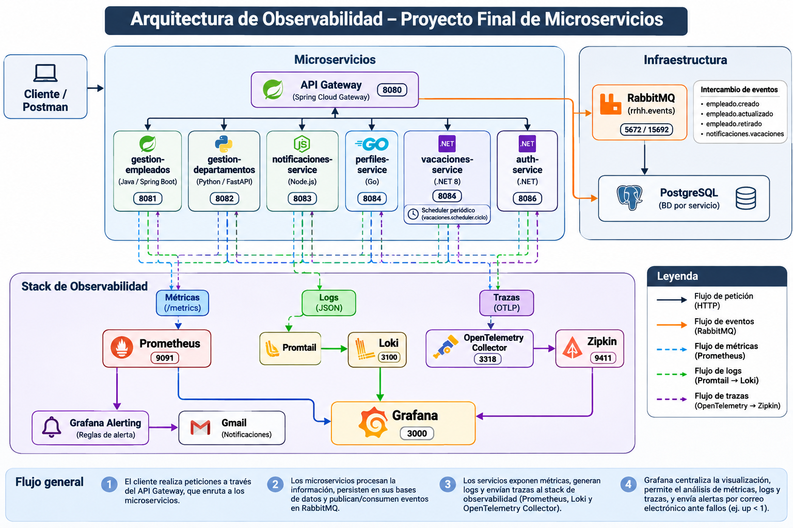


### Fundamentos de observabilidad

La solución implementada se apoya en los tres pilares principales de la observabilidad: **métricas, logs y trazas**.

- **Métricas:** permiten conocer el comportamiento general del sistema mediante valores numéricos como disponibilidad, cantidad de solicitudes, tasa de errores, latencia, uso de CPU y memoria. En este proyecto son recolectadas principalmente por Prometheus.
- **Logs:** permiten analizar eventos concretos ocurridos dentro de cada servicio. Los microservicios generan logs estructurados en JSON y Promtail los envía a Loki para su consulta centralizada desde Grafana.
- **Trazas:** permiten seguir una operación completa mientras atraviesa diferentes microservicios, bases de datos y componentes asíncronos. OpenTelemetry genera y propaga este contexto y Zipkin permite visualizarlo.

El uso conjunto de estos tres pilares facilita pasar desde una visión general del estado del sistema hasta el análisis detallado de una solicitud específica.

#### Modelo Pull y Push

La arquitectura utiliza ambos modelos de recolección de telemetría.

**Prometheus utiliza principalmente un modelo Pull.** Esto significa que Prometheus consulta periódicamente los endpoints de métricas de cada servicio, por ejemplo `/metrics` o `/prometheus`, y obtiene los valores disponibles.

```text
Prometheus
    ↓ consulta
Microservicio /metrics
```

En cambio, las **trazas utilizan un modelo Push**. Cada servicio instrumentado envía sus spans mediante OTLP/HTTP hacia OpenTelemetry Collector.

```text
Microservicio
    ↓ envía spans
OpenTelemetry Collector
    ↓
Zipkin
```

Esta diferencia permite que Prometheus controle el ritmo de recolección de métricas, mientras que las trazas son enviadas cuando las operaciones ocurren.

#### OpenTelemetry y CNCF

OpenTelemetry se utilizó como estándar común de instrumentación para los diferentes lenguajes presentes en la arquitectura.

OpenTelemetry es un proyecto de la **Cloud Native Computing Foundation (CNCF)** y proporciona APIs, SDKs y protocolos para trabajar con telemetría de forma independiente del proveedor de almacenamiento o visualización.

Esto resulta especialmente importante en una arquitectura políglota como esta, porque permite instrumentar servicios desarrollados en Java, Python, Node.js, Go y .NET utilizando un mismo enfoque.

Además, evita acoplar los microservicios directamente a Zipkin. Los servicios exportan sus trazas mediante OTLP hacia OpenTelemetry Collector y el Collector es quien las envía posteriormente al backend seleccionado.

```text
Microservicios
      ↓ OTLP
OpenTelemetry Collector
      ↓
Zipkin
```

Por esta razón, si en el futuro se reemplazara Zipkin por otro backend compatible, sería posible hacerlo con cambios mínimos en los microservicios.

#### W3C Trace Context

Para mantener el contexto de una misma operación entre diferentes servicios se utiliza el estándar **W3C Trace Context**.

El principal header utilizado es:

```text
traceparent
```

Este header transporta información como el identificador de la traza, el identificador del span padre y los flags de trazabilidad.

Gracias a este mecanismo, una solicitud puede mantener el mismo `Trace ID` mientras atraviesa el API Gateway, los microservicios y también comunicaciones asíncronas mediante RabbitMQ.


### Levantar el stack

Todo el entorno se encuentra definido mediante Docker Compose.

Desde la raíz del proyecto se puede iniciar la arquitectura completa con:

```bash
docker compose up -d
```

Para reconstruir los servicios después de realizar modificaciones:

```bash
docker compose up -d --build
```

El estado de los contenedores puede verificarse mediante:

```bash
docker ps
```

Para detener el entorno:

```bash
docker compose down
```

---

### Puertos principales

| Componente | Puerto | Uso |
|---|---:|---|
| API Gateway | 8080 | Punto de entrada a la arquitectura |
| gestion-empleados | 8081 | Servicio de empleados |
| gestion-departamentos | 8082 | Servicio de departamentos |
| notificaciones-service | 8083 | Servicio de notificaciones |
| perfiles-service | 8084 | Servicio de perfiles |
| vacaciones-service | 8085 | Servicio de vacaciones |
| auth-service | 8086 | Servicio de autenticación |
| Grafana | 3000 | Dashboards y alertas |
| Prometheus | 9091 | Métricas |
| Loki | 3100 | Almacenamiento de logs |
| OpenTelemetry Collector | 4318 | Recepción de trazas OTLP/HTTP |
| Zipkin | 9411 | Visualización de trazas |
| RabbitMQ | 5672 | Comunicación AMQP |
| RabbitMQ Management | 15672 | Interfaz de administración |
| RabbitMQ Prometheus | 15692 | Métricas del broker |

---

### Health checks

Cada microservicio expone un endpoint `/health` para verificar su estado.

Los servicios pueden responder con:

```text
HTTP 200
```

cuando se encuentran disponibles, o:

```text
HTTP 503
```

cuando una dependencia crítica no está disponible.

Los endpoints internos son:

| Servicio | Endpoint |
|---|---|
| API Gateway | `http://api-gateway:8080/health` |
| gestion-empleados | `http://gestion-empleados:8081/health` |
| gestion-departamentos | `http://gestion-departamentos:8082/health` |
| notificaciones-service | `http://notificaciones-service:8083/health` |
| perfiles-service | `http://perfiles-service:8084/health` |
| vacaciones-service | `http://vacaciones-service:8085/health` |
| auth-service | `http://auth-service:8086/health` |

Por ejemplo, cuando `auth-service` funciona correctamente puede responder:

```json
{
  "status": "UP",
  "checks": {
    "database": "UP"
  }
}
```

Si su base de datos deja de estar disponible, el mismo endpoint responde con HTTP `503`:

```json
{
  "status": "DOWN",
  "checks": {
    "database": "DOWN"
  }
}
```

---

### Métricas con Prometheus

Los microservicios exponen métricas compatibles con Prometheus.

Dependiendo de la tecnología utilizada, los endpoints son `/metrics` o `/prometheus`.

| Servicio | Endpoint de métricas |
|---|---|
| API Gateway | `/prometheus` |
| gestion-empleados | `/prometheus` |
| gestion-departamentos | `/metrics` |
| notificaciones-service | `/metrics` |
| perfiles-service | `/metrics` |
| vacaciones-service | `/metrics` |
| auth-service | `/metrics` |
| RabbitMQ | `:15692/metrics` |

Prometheus se encuentra disponible en:

```text
http://localhost:9091
```

Desde **Status / Targets** se puede comprobar que cada componente monitoreado se encuentre en estado `UP`.

Entre las métricas utilizadas se encuentran:

- disponibilidad de los servicios;
- cantidad de solicitudes HTTP;
- respuestas HTTP 4xx y 5xx;
- latencia promedio;
- percentil 95 de latencia;
- consumo de CPU;
- consumo de memoria.

---

### Dashboard de Grafana

Grafana se encuentra disponible en:

```text
http://localhost:3000
```

Se creó el dashboard:

```text
Estado del servicio
```

que permite visualizar:

- disponibilidad de los servicios;
- solicitudes HTTP por servicio;
- errores HTTP por servicio;
- latencia promedio;
- latencia p95;
- uso de CPU;
- uso de memoria.

El dashboard fue exportado y se encuentra versionado dentro del proyecto en:

```text
observabilidad/grafana/dashboards/Estado-servicio.json
```

Prometheus está configurado como fuente de datos de Grafana utilizando:

```text
http://prometheus:9090
```


### Aprovisionamiento automático de Grafana

Para que la configuración sea reproducible y no dependa de configuraciones realizadas manualmente desde la interfaz de Grafana, se implementó **provisioning mediante archivos versionados en el repositorio**.

Al iniciar Grafana, este carga automáticamente la configuración definida dentro de:

```text
observabilidad/grafana/provisioning/
```

Se aprovisionan los siguientes recursos:

- datasource de Prometheus;
- datasource de Loki;
- dashboard `Estado del servicio`;
- reglas de alerta;
- contact point de correo electrónico.

El provider del dashboard busca los archivos JSON almacenados en:

```text
observabilidad/grafana/dashboards/
```

Por lo tanto, una persona que clone el repositorio y ejecute:

```bash
docker compose up -d --build
```

obtendrá automáticamente el dashboard y los recursos de Grafana definidos en el proyecto, sin tener que recrearlos manualmente desde la interfaz.

Las credenciales sensibles necesarias para SMTP se reciben mediante variables de entorno y no se almacenan directamente en los archivos versionados.


---

### Logs centralizados con Loki

Los servicios generan logs estructurados en formato JSON.

Los logs incluyen, cuando aplica, campos como:

```json
{
  "timestamp": "...",
  "level": "INFO",
  "service": "auth-service",
  "message": "POST /auth/login status=200",
  "traceId": "...",
  "spanId": "...",
  "method": "POST",
  "path": "/auth/login",
  "status": 200
}
```

Promtail recolecta los logs de los contenedores Docker y los envía a Loki.

Loki está configurado como datasource de Grafana mediante:

```text
http://loki:3100
```

Los logs pueden consultarse desde:

```text
Grafana → Explore → Loki
```

Por ejemplo, para visualizar los logs de `auth-service`:

```logql
{container="auth-service"}
```

Para interpretar los campos JSON:

```logql
{container="auth-service"} | json
```

Para consultar únicamente logs de nivel `INFO`:

```logql
{container="auth-service"} | json | level="INFO"
```

También es posible buscar los logs asociados a una traza específica:

```logql
{container="auth-service"} | json | traceId="TRACE_ID"
```

Esto permite relacionar los logs de una operación con la traza correspondiente en Zipkin.

---


### Librerías de observabilidad utilizadas por microservicio

Debido a que la solución está construida con diferentes lenguajes y frameworks, cada servicio utiliza librerías adaptadas a su tecnología.

| Servicio | Tecnología | Métricas | Trazas | Logs estructurados |
|---|---|---|---|---|
| API Gateway | Spring Boot / Spring Cloud Gateway | Spring Boot Actuator + Micrometer Prometheus | OpenTelemetry Spring Boot Starter | Logback + Logstash Encoder |
| gestion-empleados | Spring Boot | Spring Boot Actuator + Micrometer Prometheus | OpenTelemetry Spring Boot Starter | Logback + Logstash Encoder |
| gestion-departamentos | FastAPI / Python | `prometheus-fastapi-instrumentator` | OpenTelemetry para FastAPI/Uvicorn | logging estructurado en JSON |
| notificaciones-service | Node.js | cliente Prometheus para Node.js | OpenTelemetry Node.js Auto Instrumentation | logs JSON |
| perfiles-service | Go | Prometheus Client para Go | OpenTelemetry Go | logs JSON |
| vacaciones-service | .NET 8 | OpenTelemetry Prometheus ASP.NET + Runtime + Process instrumentation | OpenTelemetry ASP.NET Core, HTTP y OTLP | logs estructurados en JSON |
| auth-service | .NET 8 | OpenTelemetry Prometheus ASP.NET + Runtime + Process instrumentation | OpenTelemetry ASP.NET Core, HTTP y OTLP | logs estructurados en JSON |

Además de la instrumentación HTTP, los servicios que publican o consumen eventos mediante RabbitMQ propagan el contexto de trazabilidad utilizando `traceparent`.


### Trazas distribuidas con OpenTelemetry y Zipkin

Los microservicios utilizan OpenTelemetry para generar y propagar el contexto de trazabilidad.

Las trazas son enviadas mediante OTLP/HTTP hacia:

```text
OpenTelemetry Collector :4318
```

El Collector posteriormente las exporta hacia Zipkin.

Zipkin se encuentra disponible en:

```text
http://localhost:9411
```

Las trazas permiten observar el recorrido completo de una solicitud entre varios servicios.

Por ejemplo:

```text
API Gateway
    ↓
gestion-empleados
    ↓
RabbitMQ
    ↓
notificaciones-service
    ↓
PostgreSQL
```

El contexto de trazabilidad también se propaga mediante RabbitMQ utilizando el header estándar:

```text
traceparent
```

Esto permite mantener el mismo `Trace ID` incluso cuando la comunicación entre servicios es asíncrona.

Se validaron, entre otros, los siguientes flujos:

```text
API Gateway → gestion-empleados → RabbitMQ → notificaciones-service
API Gateway → vacaciones-service → RabbitMQ → notificaciones-service
API Gateway → auth-service → RabbitMQ → notificaciones-service
```

---


### Elección de Zipkin frente a Jaeger

Para este reto se eligió **Zipkin** como backend de visualización de trazas distribuidas.

Tanto Zipkin como Jaeger permiten analizar trazas distribuidas y pueden integrarse con OpenTelemetry. Sin embargo, para el alcance de este proyecto se priorizó Zipkin por las siguientes razones:

- su despliegue mediante Docker es sencillo;
- requiere poca configuración inicial;
- permite visualizar servicios, trazas y spans de forma suficiente para las pruebas requeridas;
- se integra directamente con OpenTelemetry Collector;
- resulta adecuado para un entorno académico y local donde el objetivo principal es demostrar correlación y trazabilidad entre microservicios.

Jaeger también habría sido una alternativa válida, especialmente en escenarios que requieran capacidades más amplias de operación y análisis. Sin embargo, Zipkin cubre completamente las necesidades definidas para este reto con una configuración más simple.


### Tracing del scheduler de vacaciones

El servicio `vacaciones-service` contiene un scheduler periódico encargado de cambiar automáticamente el estado de las vacaciones.

Como este proceso no se origina a partir de una petición HTTP, se creó un span raíz propio mediante OpenTelemetry.

El span generado se identifica como:

```text
vacaciones.scheduler.ciclo
```

e incluye información como:

```text
scheduler.name = vacaciones
scheduler.trigger = periodic
scheduler.fecha = YYYY-MM-DD
```

Esto permite observar en Zipkin las ejecuciones internas del scheduler y relacionarlas con los eventos publicados mediante RabbitMQ.

---

### Alertas

Grafana Alerting se configuró para detectar la indisponibilidad de los servicios.

La regla utilizada evalúa la métrica:

```promql
up
```

y dispara una alerta cuando:

```text
up < 1
```

El comportamiento configurado es:

```text
Servicio disponible
up = 1
    ↓
Normal

Servicio no disponible
up = 0
    ↓
Pending
    ↓
Firing
```

La regla utiliza un período pendiente de un minuto para evitar generar alertas ante fallos extremadamente breves.

El nivel de severidad configurado es:

```text
severity = critical
```

---


### Alerta de alta latencia

Además de la detección de servicios caídos, se configuró una segunda regla para identificar incrementos importantes en el tiempo promedio de respuesta.

La regla calcula la latencia promedio utilizando las métricas disponibles según la tecnología de cada microservicio y evalúa si el valor supera:

```text
2 segundos
```

La condición debe mantenerse durante:

```text
2 minutos
```

antes de pasar al estado `Firing`.

El nivel de severidad utilizado para esta regla es:

```text
severity = warning
```

Esta alerta permite detectar servicios que continúan disponibles pero presentan una degradación importante en su rendimiento.

Las dos reglas configuradas son:

| Regla | Condición | Pending | Severidad |
|---|---|---:|---|
| Servicio caído | `up < 1` | 1 minuto | `critical` |
| Alta Latencia | latencia promedio `> 2 s` | 2 minutos | `warning` |

Ambas reglas se encuentran también definidas mediante provisioning, por lo que pueden ser cargadas automáticamente por Grafana durante el arranque del entorno.


### Notificaciones por correo

Grafana utiliza un contact point de tipo `Email`.

El envío se realiza mediante SMTP de Gmail y permite recibir una notificación cuando una regla entra en estado `Firing`.

El flujo de alerta es:

```text
Prometheus
    ↓
Grafana Alerting
    ↓
Regla up < 1
    ↓
Estado Firing
    ↓
Contact point Gmail
    ↓
Correo electrónico
```

El funcionamiento fue comprobado deteniendo intencionalmente un microservicio. Prometheus detectó el cambio de `up = 1` a `up = 0`, Grafana activó la alerta y posteriormente se recibió el correo electrónico correspondiente.

Las credenciales SMTP no se almacenan directamente en el código fuente y se configuran mediante variables de entorno.

---

### Correlación entre métricas, logs y trazas

La solución implementada permite utilizar conjuntamente las tres fuentes principales de observabilidad.

Ante un incidente se puede seguir un flujo como:

```text
1. Grafana detecta un comportamiento anormal mediante una métrica.

2. Prometheus permite identificar qué servicio está afectado.

3. Loki permite consultar los logs del servicio.

4. El traceId presente en los logs puede utilizarse para localizar la operación en Zipkin.

5. Zipkin permite observar el recorrido completo de la solicitud entre los diferentes componentes.
```

De esta manera se puede pasar desde una alerta general hasta el análisis detallado de una operación específica.

---


### Análisis del servicio con mayor tiempo de respuesta

Durante las pruebas de observabilidad se comparó la latencia promedio reportada por Prometheus y visualizada en Grafana para los diferentes servicios.

En la verificación realizada, `gestion-empleados` presentó el valor promedio más alto entre los microservicios observados, con aproximadamente:

```text
0.019651 s
```

es decir, cerca de:

```text
19.65 ms
```

El API Gateway presentó un valor muy cercano, alrededor de `0.01963 s`.

La identificación se realizó principalmente mediante el panel de **latencia promedio por servicio** del dashboard de Grafana. Posteriormente, Zipkin permitió complementar el análisis observando los spans y el recorrido de las solicitudes distribuidas.

Por lo tanto, ante la pregunta:

> ¿Qué servicio del ecosistema tardó más en responder y cómo lo identificaron?

la respuesta obtenida durante la prueba fue `gestion-empleados`. Se identificó comparando las métricas de latencia en Prometheus/Grafana y utilizando Zipkin para analizar el detalle de las operaciones distribuidas.

Estos valores corresponden al momento de la prueba y pueden variar dependiendo de la carga, el número de solicitudes, el estado de las bases de datos y los recursos disponibles en el entorno.


### Resumen del stack

| Área | Herramienta |
|---|---|
| Métricas | Prometheus |
| Visualización | Grafana |
| Logs | Promtail + Loki |
| Instrumentación | OpenTelemetry |
| Recolección de trazas | OpenTelemetry Collector |
| Visualización de trazas | Zipkin |
| Alertas | Grafana Alerting |
| Notificaciones | Gmail SMTP |
| Broker monitoreado | RabbitMQ Prometheus Plugin |
| Health checks | `/health` por microservicio |
| Provisioning de Grafana | Datasources, dashboard, alertas y contact point versionados |
## Chaos Testing

Con el objetivo de validar el comportamiento del sistema ante fallos controlados, se realizaron diferentes pruebas de caos sobre componentes críticos de la arquitectura. Estas pruebas permitieron comprobar que la plataforma de observabilidad detecta correctamente indisponibilidades, errores de comunicación y fallos en dependencias.

### 1. Caída del microservicio `gestion-departamentos`

Para comprobar la detección de indisponibilidad de un microservicio, se detuvo de forma intencional el contenedor de `gestion-departamentos`.

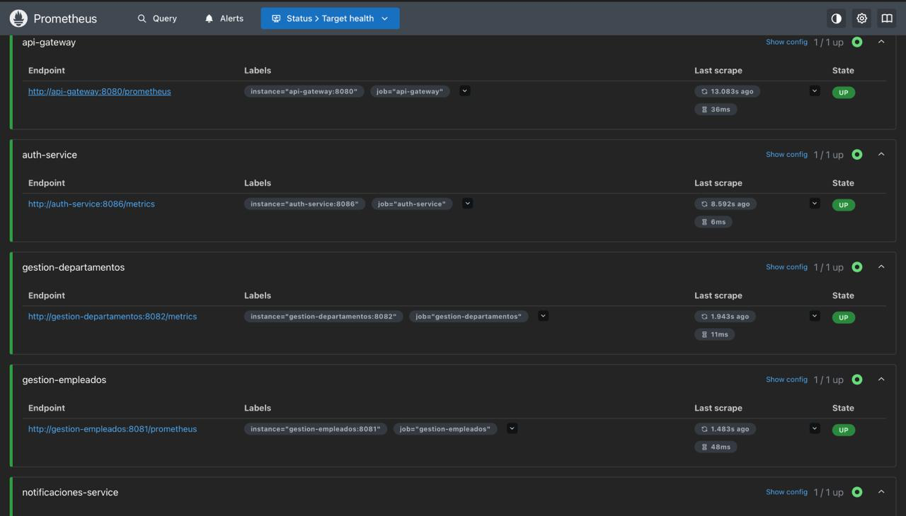

```bash
docker stop gestion-departamentos
```
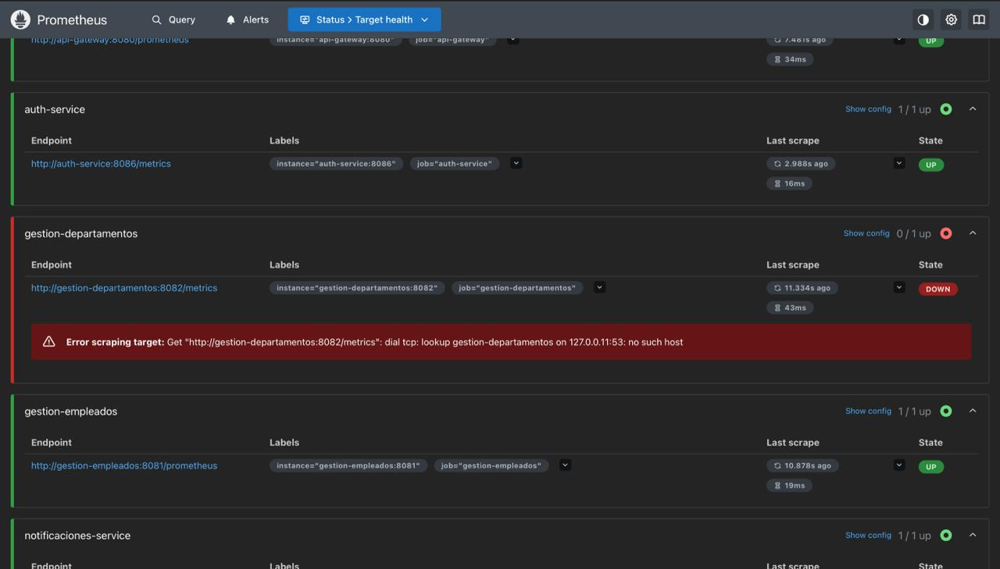

Antes de realizar la prueba, el servicio se encontraba disponible y Prometheus reportaba:

```promql
up{job="gestion-departamentos"}
```

con un valor igual a:

```text
1
```

Después de detener el contenedor, Prometheus detectó la caída y la métrica cambió a:

```text
0
```

La consulta realizada directamente sobre Prometheus confirmó la indisponibilidad:

```bash
curl -s 'http://localhost:9091/api/v1/query?query=up%7Bjob%3D%22gestion-departamentos%22%7D'
```

Grafana detectó el cambio de estado mediante la regla de alerta configurada con la condición:

```text
up < 1
```

La alerta pasó primero al estado `Pending` y posteriormente a `Firing`, indicando que el servicio permanecía fuera de línea.

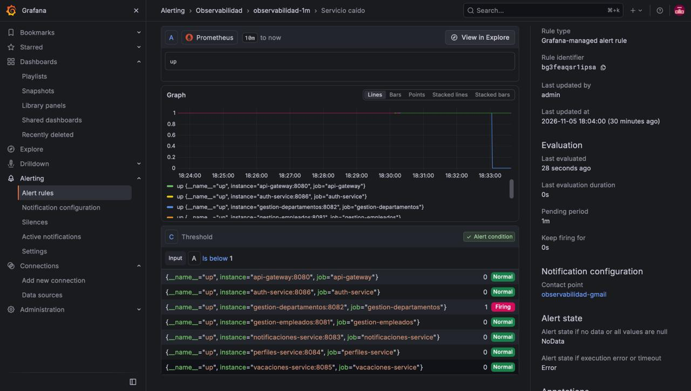

Además, el contact point configurado mediante Gmail envió correctamente una notificación por correo electrónico informando la caída del servicio.

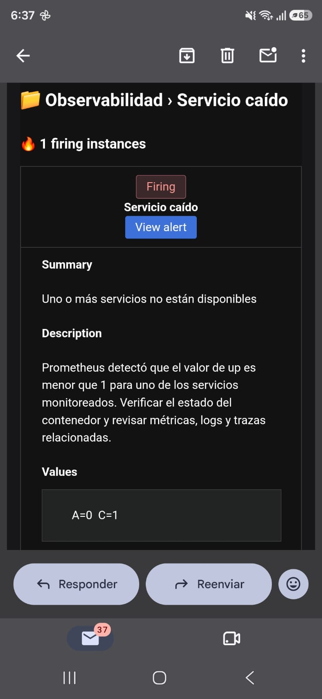

El servicio fue recuperado mediante:

```bash
docker start gestion-departamentos
```

Después de su recuperación, Prometheus volvió a registrar:

```text
up = 1
```

y la alerta regresó al estado normal.

**Resultado:** el sistema de monitoreo detectó correctamente la caída del microservicio, generó una alerta y notificó al responsable mediante correo electrónico.

---

### 2. Caída de RabbitMQ

El segundo escenario consistió en comprobar qué ocurre cuando el broker de mensajería RabbitMQ deja de estar disponible.

RabbitMQ fue incorporado previamente como target de Prometheus mediante su endpoint de métricas en el puerto `15692`.

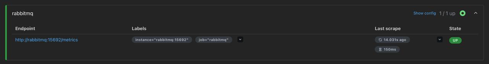

En condiciones normales, Prometheus registraba:

```promql
up{job="rabbitmq"}
```

con valor:

```text
1
```

Para provocar el fallo se ejecutó:

```bash
docker stop rabbitmq
```
Después del siguiente ciclo de scraping, Prometheus detectó correctamente la caída del broker y la métrica pasó a:

```text
0
```
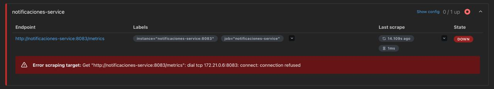

Con RabbitMQ detenido, se realizó la creación de un empleado mediante el endpoint correspondiente de `gestion-empleados`.

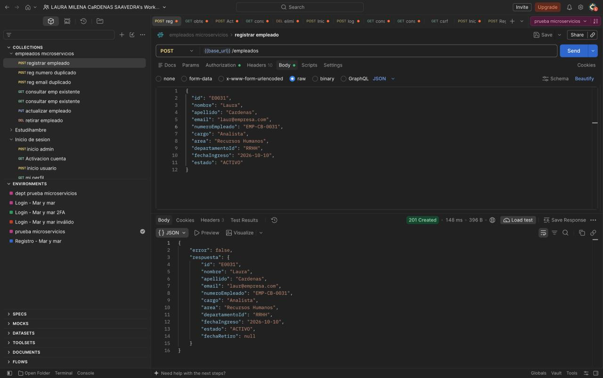

El servicio logró persistir correctamente la información del empleado en PostgreSQL, pero al intentar publicar el evento `empleado.creado` se produjo un error de conexión con RabbitMQ.

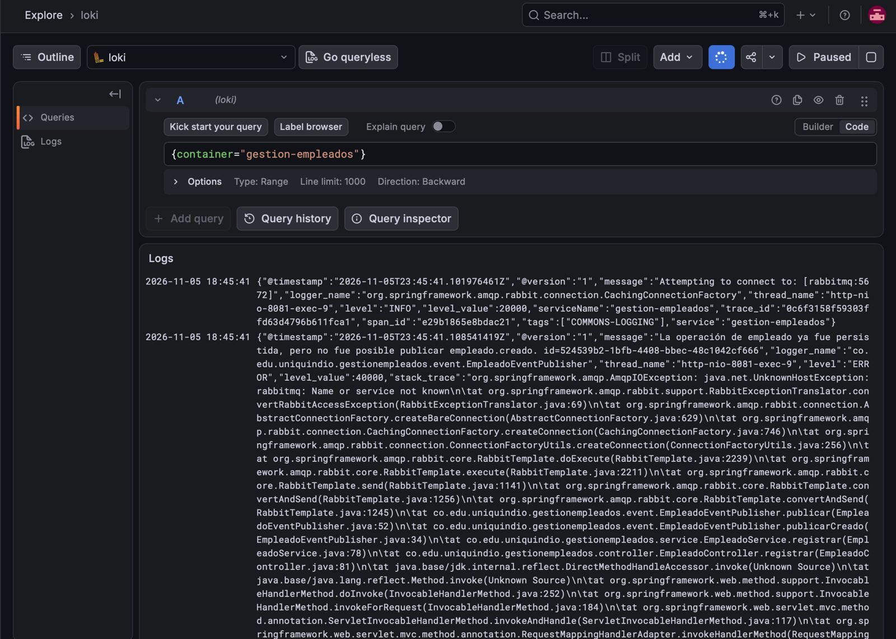

Los logs centralizados en Loki permitieron observar mensajes como:

```text
Attempting to connect to: [rabbitmq:5672]
```

y posteriormente:

```text
La operación de empleado ya fue persistida, pero no fue posible publicar empleado.creado
```

Esto confirmó el comportamiento diseñado para el servicio: la operación de base de datos no se revierte cuando falla la publicación del evento, y el error queda registrado para su análisis.

Finalmente, RabbitMQ fue recuperado con:

```bash
docker start rabbitmq
```

y Prometheus volvió a registrar:

```text
up = 1
```

**Resultado:** la caída del broker fue detectada por Prometheus y el fallo de publicación pudo observarse mediante los logs centralizados en Loki. La persistencia principal de `gestion-empleados` se mantuvo disponible a pesar de la indisponibilidad temporal del broker.

---

### 3. Caída de la base de datos de `auth-service`

El tercer escenario tuvo como objetivo comprobar que los health checks detectan correctamente la pérdida de una dependencia crítica.

Se utilizó la base de datos PostgreSQL correspondiente a `auth-service`, cuyo contenedor es:

```text
database-auth
```

En condiciones normales, el endpoint interno de salud respondía correctamente:

```bash
docker exec auth-service curl -i http://localhost:8086/health
```
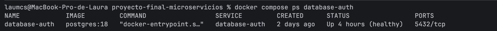

con:

```text
HTTP/1.1 200 OK
```

y un cuerpo equivalente a:

```json
{
  "status": "UP",
  "checks": {
    "database": "UP"
  }
}
```

Para simular el fallo se detuvo únicamente la base de datos:

```bash
docker stop database-auth
```

Posteriormente se volvió a consultar el health check:

```bash
docker exec auth-service curl -i http://localhost:8086/health
```
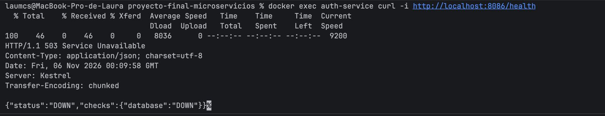

El servicio respondió:

```text
HTTP/1.1 503 Service Unavailable
```

con el siguiente estado:

```json
{
  "status": "DOWN",
  "checks": {
    "database": "DOWN"
  }
}
```

Esto demuestra que `auth-service` continúa ejecutándose, pero informa correctamente que no se encuentra saludable debido a la pérdida de su base de datos.

Finalmente, la base de datos fue recuperada mediante:

```bash
docker start database-auth
```

Después de su recuperación, el endpoint `/health` volvió a responder con código HTTP `200` y estado `UP`.

**Resultado:** el health check detectó correctamente la indisponibilidad de PostgreSQL y devolvió `503 Service Unavailable`, permitiendo diferenciar entre un servicio completamente detenido y un servicio activo con una dependencia crítica fuera de línea.

---

### Conclusiones de las pruebas de caos

Las pruebas realizadas permitieron validar distintos tipos de fallos dentro de la arquitectura:

| Escenario | Detección | Evidencia |
|---|---|---|
| Caída de `gestion-departamentos` | Prometheus y Grafana | `up = 0`, alerta `Firing` y correo electrónico |
| Caída de RabbitMQ | Prometheus y Loki | `up = 0` y error de publicación de eventos |
| Caída de `database-auth` | Health check | HTTP `503` y estado de base de datos `DOWN` |

Estos escenarios demuestran que la solución de observabilidad permite identificar problemas tanto a nivel de microservicios como de infraestructura y dependencias, utilizando métricas, logs, health checks y alertas para facilitar el diagnóstico y la recuperación del sistema.
