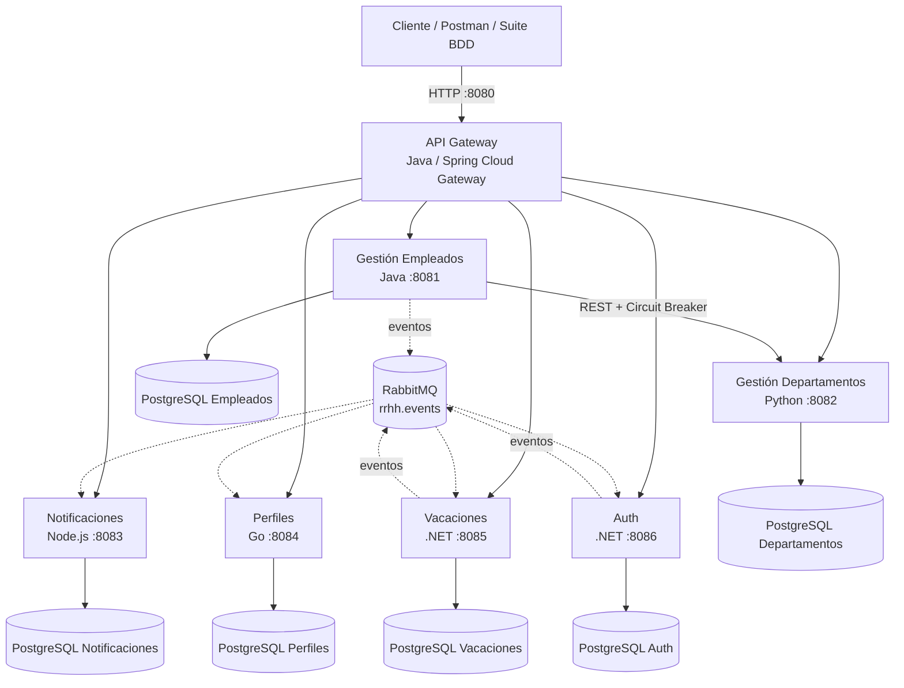
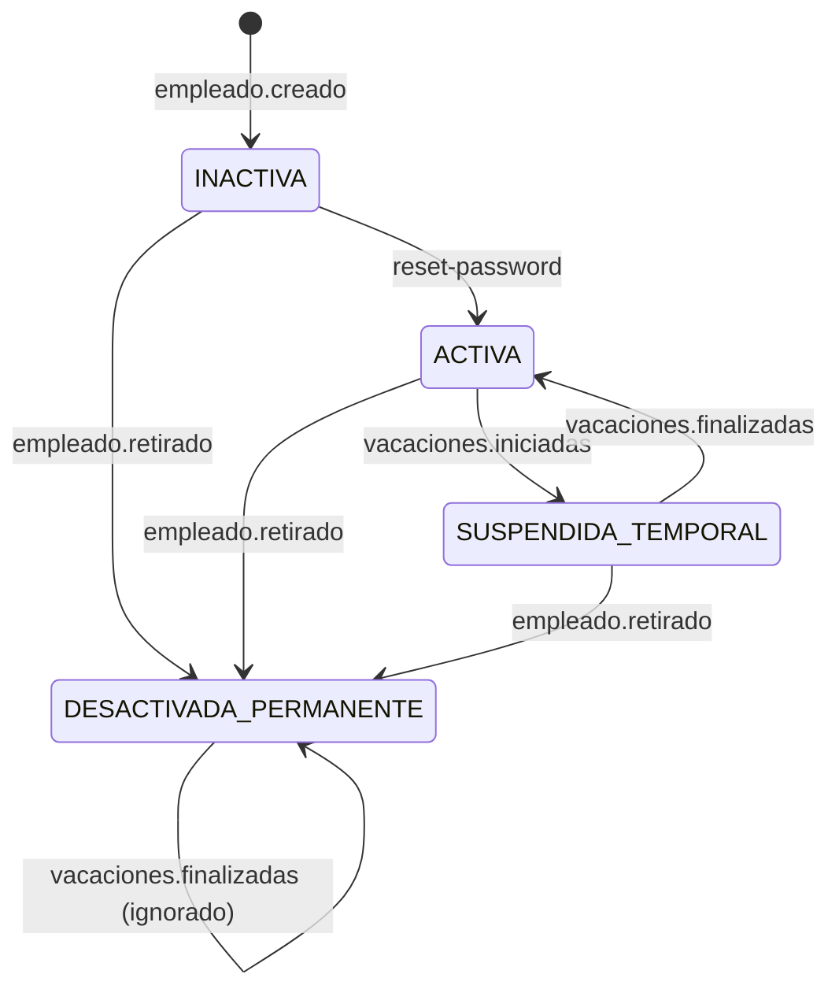

# Arquitectura actual del proyecto (Retos 1 a 6)

## Vista general



## Punto de entrada único

El único puerto de negocio publicado al host es `8080`, correspondiente al API Gateway. Los microservicios usan `expose` y se resuelven por nombre dentro de `microservices-network`. RabbitMQ publica únicamente su interfaz administrativa en `127.0.0.1:15672`.

## Seguridad (Reto 5)

El Gateway valida el JWT antes de enrutar la petición. Las reglas principales son:

| Caso | Resultado |
|---|---|
| Ruta protegida sin token o token inválido | `401 Unauthorized` |
| `ADMIN` | Acceso total |
| `USER` + lectura | Permitido |
| `USER` + escritura general | `403 Forbidden` |
| `USER` + `POST /auth/change-password` | Permitido |
| `USER` + `PUT /perfiles/{suEmpleadoId}` | Permitido por propiedad del recurso |
| `USER` + perfil ajeno | `403 Forbidden` |

El Gateway propaga `X-User-Id` y `X-User-Role` a los servicios internos después de validar el token.

## Ciclo de vida de la cuenta



## Pruebas (Reto 6)

La estrategia se divide en tres niveles:

```text
E2E / BDD       -> e2e-tests/ con Cucumber.js
Integración     -> gestion-empleados + PostgreSQL real con Testcontainers
Unitarias       -> gestion-empleados (JUnit/Mockito) y vacaciones-service (xUnit)
```

La suite BDD llama únicamente a `BASE_URL` (por defecto `http://localhost:8080`) y nunca a los puertos internos de los microservicios.
